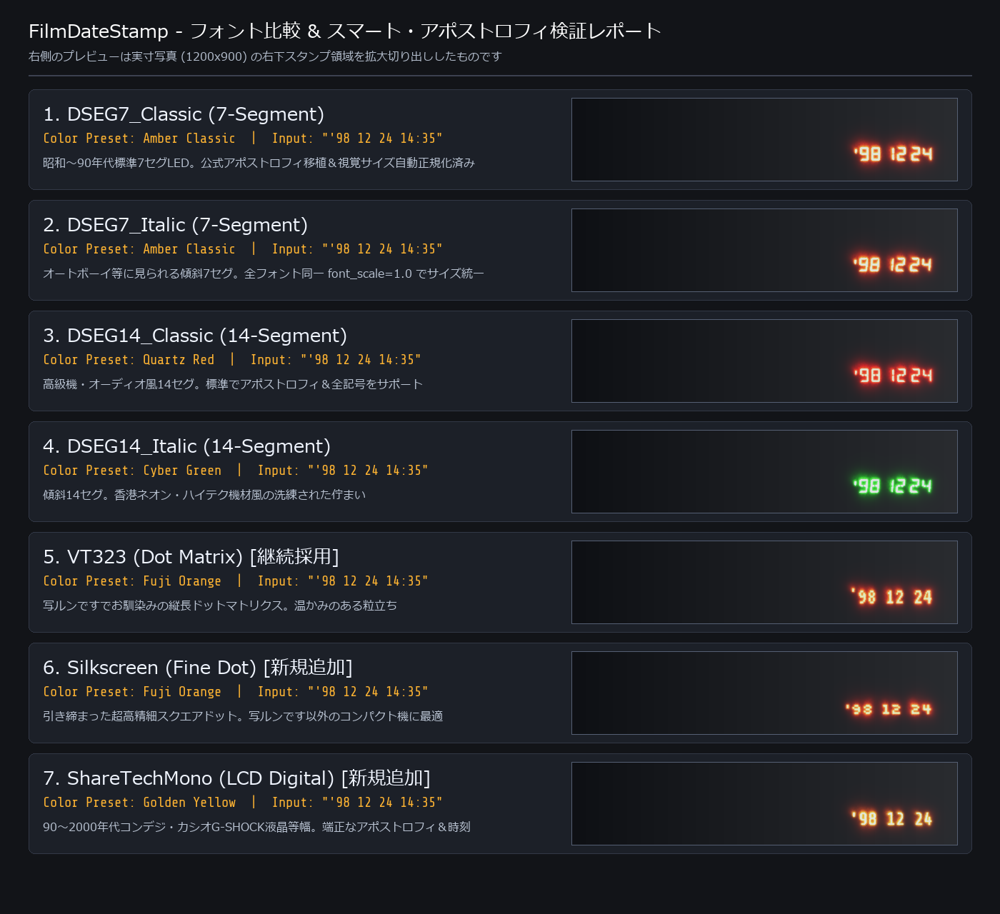

# FilmDateStamp (ComfyUI Custom Node)

フィルム写真の感光乳剤に焼き付けられる「クォーツデート（日付スタンプ）」の光学・物理質感を徹底追及した、ComfyUI専用のカスタムノードパッケージです。

単なる「文字の貼り付け（透過オーバーレイ）」ではなく、**「フィルム乳剤へのLED露光（光の焼き付け）」**を物理的にシミュレートします。



---

## 🌟 主な特徴

1. **光学感光（Optical Burn-in）モデル**
   - フィルム乳剤への光子照射をシミュレート（加算露光 ＋ Reinhardハイライト肩特性ロールオフ）。
   - **ハイライト埋もれ再現**: 背景が明るい／白い写真では、感光乳剤が飽和して日付の光が自然に溶け込んで見えにくくなる「実物の白飛び現象」を忠実に再現。
2. **3層光路モデル（3-Layer Optical Path）**
   - **高輝度コア（Core）**: 中心部の光量が乳剤を完全飽和させる白〜淡黄色の極タイトな芯。
   - **主発光体（Body）**: 琥珀色（アンバー）〜オレンジの鮮やかな発光体。
   - **フィルム内光散乱（Halation）**: 乳剤層・ベース層内で長波長（赤色）が横方向に散乱して滲む赤色の微細グロー。
3. **時代考証と多彩なフォント（全7種）**
   - `DSEG7_Classic / Italic (7-Segment)`: 往年の名機に見られる直立／11.5度傾斜7セグ（公式アポストロフィ移植済みで豆腐になりません）。
   - `DSEG14_Classic / Italic (14-Segment)`: 高級Hi-Fi機器・特殊カメラ調の14セグメントLED。
   - `VT323 (Dot Matrix)`: 「写ルンです」等の温かみのある縦長ドットマトリクス。
   - `Silkscreen (Fine Dot)`: 引き締まった正方形の超高精細ドット（8px調）。
   - `ShareTechMono (LCD Digital)`: 90〜2000年代初期コンデジ・カシオG-SHOCK風液晶等幅。
4. **視覚サイズ自動正規化（Visual Size Normalization）**
   - フォント内部の余白・仮想ボディ比率の差を自動吸収。フォントを切り替えても、同じ `font_scale` で均一な大きさと右下端の正確なマージン位置を維持します。
5. **柔軟な日付生成と独立した時刻トグル (`show_time`)**
   - **フォーマットと時刻の完全分離**: 日付の並び順（年月日）と時刻表示（`HH:MM`）を独立制御。どの日付フォーマットを選んでいても、`show_time` を ON/OFF するだけで時刻の有無を自在に切り替えられます。
   - `custom`: 自由入力（例: `'98 12 24`）。
     - `show_time = False`: 文字列に時刻が含まれていても自動で除去して日付のみを描画。
     - `show_time = True`: 文字列に時刻があればそのまま維持し、日付のみの場合はデフォルト（`18:30`）を自動補完。
   - `current_date`: 実行時の現在日時を自動フォーマット（`show_time = True` で現在時刻も併記）。
   - `random_vintage`: 1985〜2005年のランダムな日時を自動生成（エモいオールドフォト生成に最適、`show_time = True` でランダムな時刻も併記）。
6. **地域・文化・時代を想起させる新スタイルプリセット**
   - `Japanese Tokyo 90s`: 90年代日本の街角・日常スナップ（'YY MM DD / 7セグ斜体 / アンバー / `show_time: false`）
   - `Japanese Snap (Disposable)`: 写ルンです風・縦長ドット・時分併記（'YY MM DD HH:MM / オレンジ / `show_time: true`）
   - `American West Coast`: 90年代西海岸・ロードトリップ（MM DD 'YY / 7セグ斜体 / ゴールデン / `show_time: false`）
   - `American 80s (Red Quartz)`: 80年代モーテル・ホームビデオ・赤色LED（MM DD 'YY / 7セグ直立 / クォーツレッド / `show_time: false`）
   - `European Classic (Paris/Berlin)`: 欧州の石畳・上品な佇まい（DD.MM.YY / 7セグ直立 / 控えめアンバー / `show_time: false`）
   - `Hong Kong Neon (90s Cinema)`: 90年代香港ネオン映画調（'YY MM DD / 14セグ斜体 / サイバーグリーン / `show_time: false`）
   - `Y2K Digicam (Early 2000s)`: 2000年代初期コンデジLCD液晶（'YY MM DD HH:MM / 液晶等幅 / ゴールデン / `show_time: true`）
   - `Compact Fine Dot (Minimal)`: 超高精細スクエアドットマトリクス（'YY MM DD HH:MM / 高精細ドット / オレンジ / `show_time: true`）
7. **多機能な出力スロット（MASK & STRING 対応）**
   - **`IMAGE`**: 物理露光が焼き付けられた完成画像。
   - **`MASK`**: スタンプ発光領域の高精度アルファマスク（0.0〜1.0）。文字コアは完全な白（1.0）、ハレーション部分は滑らかな減衰グラデーションとなり、後段で日付部分だけにフィルム粒子を乗せたり、Inpaintで日付を除去する際に活用可能。
   - **`STRING`**: 実際に描画された日付文字列（例: `'98 12 24 18:30`）。`random_vintage` や `current_date` で動的に生成された日時を、ファイル保存名（SaveImage の filename_prefix）やキャプション等にシームレスに連携可能。

---

## 📦 インストール方法

### 方法 1: ComfyUI-Manager（推奨）
ComfyUI-Manager の検索ウィンドウで `Film Date Stamp` または `FilmDateStamp` を検索し、「Install」をクリックしてください。

### 方法 2: Git Clone
ComfyUI の `custom_nodes` ディレクトリに移動し、クローンしてください：
```bash
cd ComfyUI/custom_nodes
git clone https://github.com/rec-frame/FilmDateStamp.git
```

### 方法 3: Comfy CLI
```bash
comfy node registry-install comfyui-film-date-stamp
```

---

## 🚀 使い方

1. ComfyUI のノード追加メニューより、`image` > `film` > **`Film Date Stamp (Optical Burn-in)`** を選択。
2. 最上段の **`style_preset`** からお好みの世界観（`Japanese Tokyo 90s` や `American West Coast` など）を選ぶと、フォント・色・発光・日付順が一発で自動セットされます。
3. パラメータを手動で動かすと自動的に `Custom` に切り替わり、自由な微調整が可能です。
4. サンプルワークフローは `workflows/film_date_stamp_workflow.json` を ComfyUI 画面にドラッグ＆ドロップしてください。

---

## ⚙️ パラメータ仕様

| パラメータ名 | 区分 | 型 / 選択肢 | デフォルト | 説明 |
|---|---|---|---|---|
| `style_preset` | 必須 | `Custom`, `Japanese Tokyo 90s`, `American West Coast`, etc. | `Custom` | スタイル一括プリセット（最上段） |
| `font_type` | 必須 | `DSEG7`, `DSEG14`, `VT323`, `Silkscreen`, `ShareTechMono` | `DSEG7_Classic` | 発光素子タイポグラフィ（全7種） |
| `preset_color` | 必須 | `Amber Classic`, `Quartz Red`, `Fuji Orange`, `Golden Yellow`, `Cyber Green` | `Amber Classic` | 発光スペクトルプリセット |
| `exposure_intensity`| 必須 | FLOAT (0.0〜2.0) | `1.0` | 露光光量全体の強度 |
| `core_glow` | 必須 | FLOAT (0.0〜2.0) | `1.0` | 中心白コアの強さ |
| `halation` | 必須 | FLOAT (0.0〜3.0) | `1.0` | 赤色乳剤散乱の広がり・強さ |
| `optical_burn` | 必須 | BOOLEAN | `True` | 物理感光露光（True=白背景で自然に埋もれる） |
| `date_mode` | 必須 | `custom`, `current_date`, `random_vintage` | `custom` | 日付生成モード |
| `date_string` | 必須 | STRING | `'98 12 24` | `custom` モード時に使用する文字列 |
| `date_format` | 必須 | `'YY MM DD`, `MM DD 'YY`, `DD MM 'YY`, `DD.MM.YY`, `YY-MM-DD`, `YY.MM.DD`, `YYYY MM DD`, `YYYY-MM-DD` | `'YY MM DD` | 自動日時生成時のフォーマット（全8種） |
| `show_time` | 必須 | BOOLEAN | `False` | 時刻（HH:MM）の表示・非表示。ON時はフォーマット問わず末尾に時分を付加 |
| `position` | 必須 | `bottom_right`, `bottom_left`, `top_right`, `top_left` | `bottom_right` | スタンプの配置位置 |
| `font_scale` | 必須 | FLOAT (0.5〜2.5) | `1.0` | 画像短辺に対するフォントスケール |
| `margin_x` / `margin_y` | 必須 | FLOAT (0.0〜3.0) | `1.0` | 画面端からのマージン倍率 |
| `seed` | 任意 | INT | `0` | `random_vintage` の乱数再現用シード |

### 📤 出力スロット

| スロット名 | 型 | 説明 |
|---|---|---|
| `image` | `IMAGE` | 日付スタンプが光学的に露光・焼き付け合成されたテンソル画像 `[B, H, W, C]` |
| `mask` | `MASK` | スタンプ領域のアンチエイリアス付き高精度マスク `[B, H, W]`（文字部 1.0、ハレーション部 減衰値、背景 0.0） |
| `date_text` | `STRING` | 実際に描画された日付・時刻文字列（例: `'98 12 24` や `'98 12 24 18:30`）。後段の保存ノードやテキスト連携に利用可能 |

---

## 📄 ライセンス

- コード: MIT License
- 同梱フォント: SIL Open Font License 1.1 (`fonts/LICENSE-OFL.txt`)
