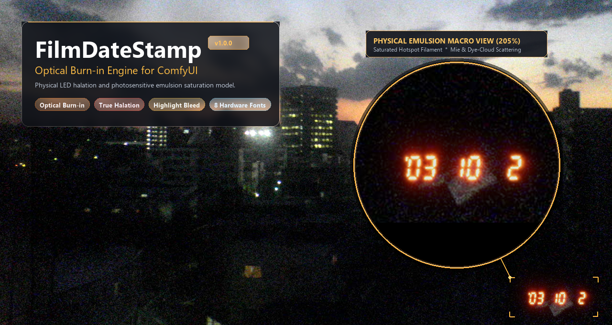
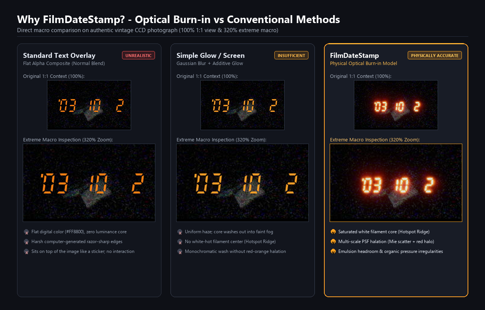
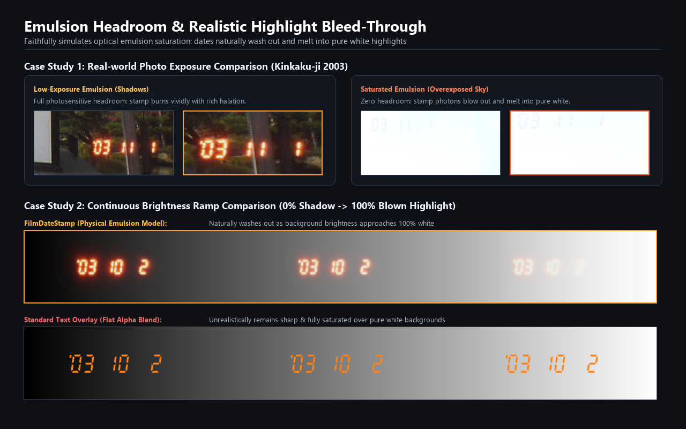
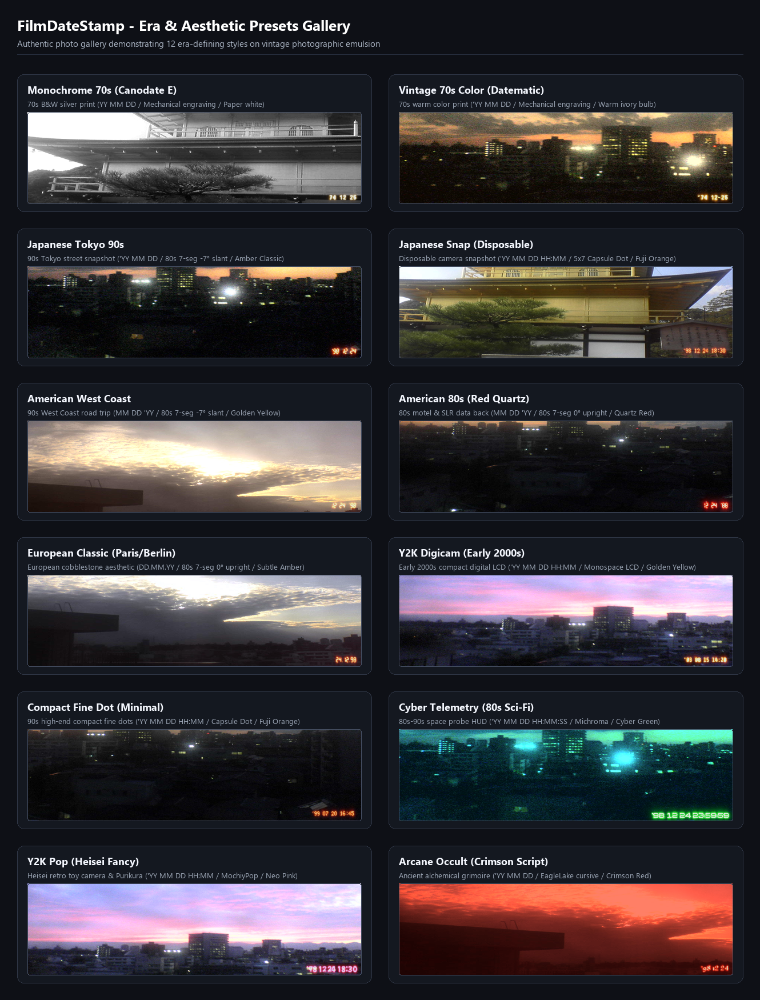

# FilmDateStamp (ComfyUI Custom Node)

[English](README.md) | [日本語](README_ja.md)



A custom node package for ComfyUI dedicated to faithfully simulating the optical and physical characteristics of camera quartz date stamps burned into photographic film emulsion.

Rather than applying a simple flat text overlay or standard blend mode, FilmDateStamp physically simulates **light-emitting diodes (LEDs) exposing the photosensitive silver halide / dye emulsion layers**.

---

## 🌟 Key Features

### 1. Optical Burn-in Physical Model vs Conventional Overlay
Simulates physical photon irradiation onto photographic film emulsion: linear-space additive exposure combined with an **unexposed emulsion headroom model** and soft shoulder roll-off.
- **Saturated Hotspot Ridge**: Segments feature a physically bleached white filament core that transitions outward into spectral orange-red halation.
- **Multi-Scale PSF Scattering**: Narrow-angle forward Mie scattering combines with wide-angle base-backplate halation.
- **Organic Irregularities (3 Tiers)**: Macro LED output variations (±10%), meso backplate pressure warping, and micro dye-cloud grain dissolution.



### 2. Realistic Highlight Bleed-Through (Emulsion Headroom)
Over bright or pure white backgrounds where the film emulsion is already saturated, the date stamp naturally blows out and melts into the background highlights—faithfully reproducing the real optical phenomenon.



### 3. Authentic Hardware Geometry & Expressive Typography (8 Curated Fonts)
- `FDSMechanical70s`: 1970s mechanical engraved dial numerals (DIN 1451 / JIS industrial engraving; Canon Canodate E / Datematic).
- `FDS7Strict-Compact`: 1980s Suwa Seikosha quartz date module geometry (-7.0° italic slant; Autoboy, L35AD, etc.).
- `FDS7Strict-SLR`: 1980s SLR camera data back geometry (0.0° upright; Nikon MF-12/14/16, etc.).
- `FDSDotStrict`: 1990s disposable camera 5×7 tall capsule dot matrix (Utsurundesu / QuickSnap).
- `ShareTechMono`: 90s–2000s early compact digital camera / Casio G-SHOCK monospace LCD.
- `Michroma`: 80s–90s sci-fi / space probe telemetry HUD (wide geometric).
- `MochiyPopOne`: Heisei retro round fancy / Purikura photo booth neon pop.
- `EagleLake`: Alchemical ledger / vintage manuscript ink cursive script.

### 4. Visual Size Normalization
Automatically absorbs internal font glyph bounding-box and EM-square differences. Switching fonts preserves identical visual size and precise corner margins at the same `font_scale`.

### 5. Intuitive Date Inputs & Timestamp Toggle (`show_time`)
- Custom string input (e.g. `'98 12 24`).
- Dynamic macros: `"auto"` or `"today"` for current runtime date; `"random"` for vintage dates (1985–2005) with reproducible seed control.
- Single-click `show_time` boolean toggle to append timestamps (`HH:MM`).

### 6. Era- & Culture-Defining Style Presets
Jump straight to iconic photography aesthetics across regions, cultures, and decades:



- `Japanese Tokyo 90s`: Everyday 90s Tokyo street snapshot ('YY MM DD / 80s 7-seg -7° / Amber Classic).
- `Japanese Snap (Disposable)`: Disposable camera look ('YY MM DD HH:MM / 5×7 Capsule Dot / Fuji Orange).
- `American West Coast`: 90s West Coast road trip (MM DD 'YY / 80s 7-seg -7° / Golden Yellow).
- `American 80s (Red Quartz)`: 80s motel / SLR red LED (MM DD 'YY / 80s 7-seg upright / Quartz Red).
- `European Classic (Paris/Berlin)`: European cobblestone aesthetic (DD.MM.YY / 80s 7-seg upright / Subtle Amber).
- `Y2K Digicam (Early 2000s)`: Early 2000s digital compact LCD ('YY MM DD HH:MM / Monospace LCD / Golden Yellow).
- `Compact Fine Dot (Minimal)`: 90s high-end compact camera fine dots ('YY MM DD HH:MM / Fuji Orange).
- `Monochrome 70s (Canodate E)`: 70s B&W silver print (YY MM DD / Mechanical / Paper White).
- `Vintage 70s Color (Datematic)`: 70s warm color print ('YY MM DD / Mechanical / Warm Ivory).
- `Cyber Telemetry (80s Sci-Fi)`: Space telemetry HUD ('YY MM DD HH:MM:SS / Michroma / Cyber Green).
- `Y2K Pop (Heisei Fancy)`: Heisei fancy neon pop ('YY MM DD HH:MM / MochiyPopOne / Neo Pink).
- `Arcane Occult (Crimson Script)`: Ancient alchemical grimoire ('YY MM DD / EagleLake / Crimson Red).

### 7. Versatile Outputs (MASK & STRING Support)
- **`IMAGE`**: The composite image tensor with physically burned-in date stamp.
- **`MASK`**: High-precision anti-aliased emission mask `[B, H, W]`. Features 1.0 white core and smooth halation falloff; ideal for downstream selective grain injection or inpainting removal.
- **`STRING` (`date_text`)**: The resolved date and time text (e.g. `'98 12 24 18:30'`). Easily feeds into SaveImage filename prefixes or captioning nodes.

---

## 📦 Installation

### Option 1: ComfyUI-Manager (Recommended)
Search for `Film Date Stamp` or `FilmDateStamp` in ComfyUI-Manager and click **Install**.

### Option 2: Git Clone
Navigate to your ComfyUI `custom_nodes` directory and clone the repository:
```bash
cd ComfyUI/custom_nodes
git clone https://github.com/rec-frame/FilmDateStamp.git
```

---

## 🚀 Quick Start

1. In ComfyUI, locate the node under: `image` > `film` > **`Film Date Stamp (Optical Burn-in)`**.
2. Select your desired vibe from the top **`style_preset`** dropdown (e.g. `Japanese Tokyo 90s` or `American West Coast`). Font, color spectrum, exposure, and date formatting will be configured instantly.
3. Adjusting any parameter manually automatically switches the preset to `Custom` for fine-tuning.
4. Drag and drop the official sample workflow (`workflows/film_date_stamp_workflow.json`) into ComfyUI to get started right away.

---

## ⚙️ Parameter Reference

| Parameter | Type / Options | Default | Description |
|---|---|---|---|
| `style_preset` | `Custom`, `Japanese Tokyo 90s`, `American West Coast`, etc. | `Custom` | Master style preset selector (top widget) |
| `font_type` | 8 curated fonts (4 strictly in-house + 1 LCD mono + 3 expressive) | `FDS7_Strict_Compact (80s -7°)` | Typography geometry |
| `preset_color` | `Amber Classic`, `Quartz Red`, `Fuji Orange`, `Golden Yellow`, `Bulb Warm Ivory`, `Paper White`, `Cyber Green`, `Neo Pink`, `Crimson Red` | `Amber Classic` | Physical emission spectral preset |
| `exposure_intensity`| FLOAT (0.0 – 2.0) | `1.0` | Overall exposure light energy |
| `core_glow` | FLOAT (0.0 – 2.0) | `1.0` | Intensity of the saturated white filament core |
| `halation` | FLOAT (0.0 – 3.0) | `1.0` | Emulsion red halo scattering radius and intensity |
| `date_string` | STRING | `'98 12 24` | Custom date string, or `"auto"`, `"today"`, `"random"` |
| `date_format` | `'YY MM DD`, `MM DD 'YY`, `DD MM 'YY`, `DD.MM.YY`, `YY-MM-DD`, `YY.MM.DD`, `YYYY MM DD`, `YYYY-MM-DD` | `'YY MM DD` | Formatting convention for dynamic dates |
| `show_time` | BOOLEAN | `False` | Toggle timestamp (`HH:MM`) display |
| `position` | `bottom_right`, `bottom_left`, `top_right`, `top_left` | `bottom_right` | Placement corner |
| `font_scale` | FLOAT (0.5 – 2.5) | `1.0` | Font scale relative to image short edge |
| `margin` | FLOAT (0.0 – 3.0) | `1.0` | Margin distance from image boundary |
| `seed` | INT | `0` | Seed for random date generation and organic irregularity |
| `irregularity` | FLOAT (0.0 – 2.0) | `1.0` | Strength of the 3-tier organic irregularity simulation |

### 📤 Output Slots

| Slot Name | Type | Description |
|---|---|---|
| `image` | `IMAGE` | Burned-in output tensor `[B, H, W, C]` |
| `mask` | `MASK` | Antialiased high-precision stamp mask `[B, H, W]` (1.0 core, falloff halation, 0.0 background) |
| `date_text` | `STRING` | The resolved text string rendered on the image (e.g. `'98 12 24 18:30'`) |

---

## 📄 License

- Code: MIT License
- Bundled Fonts: SIL Open Font License 1.1 (`fonts/LICENSE-OFL.txt`)
