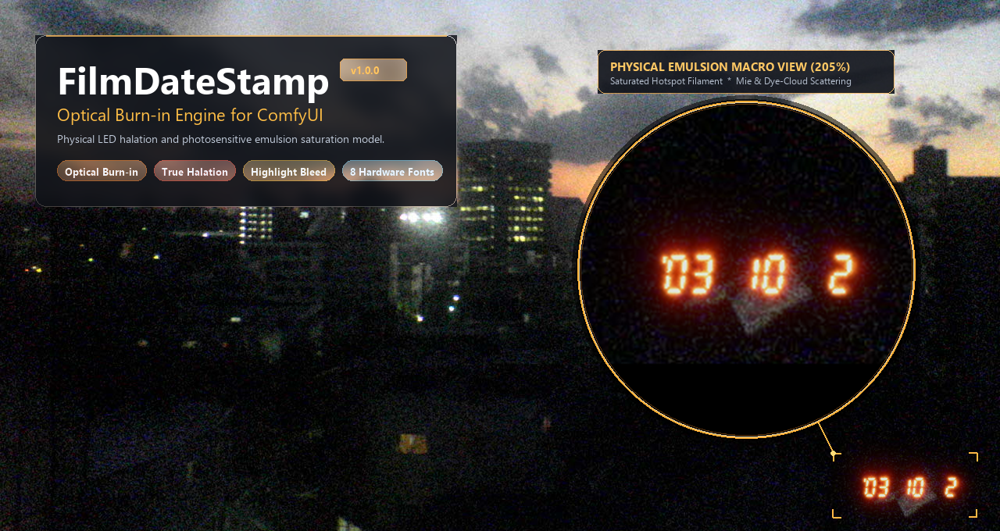
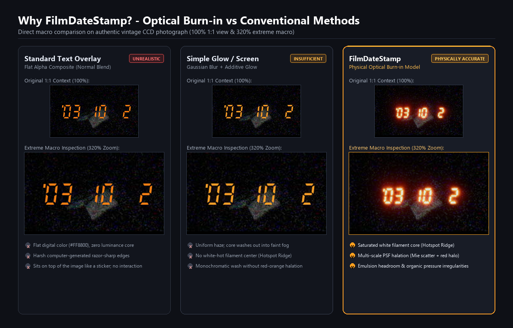
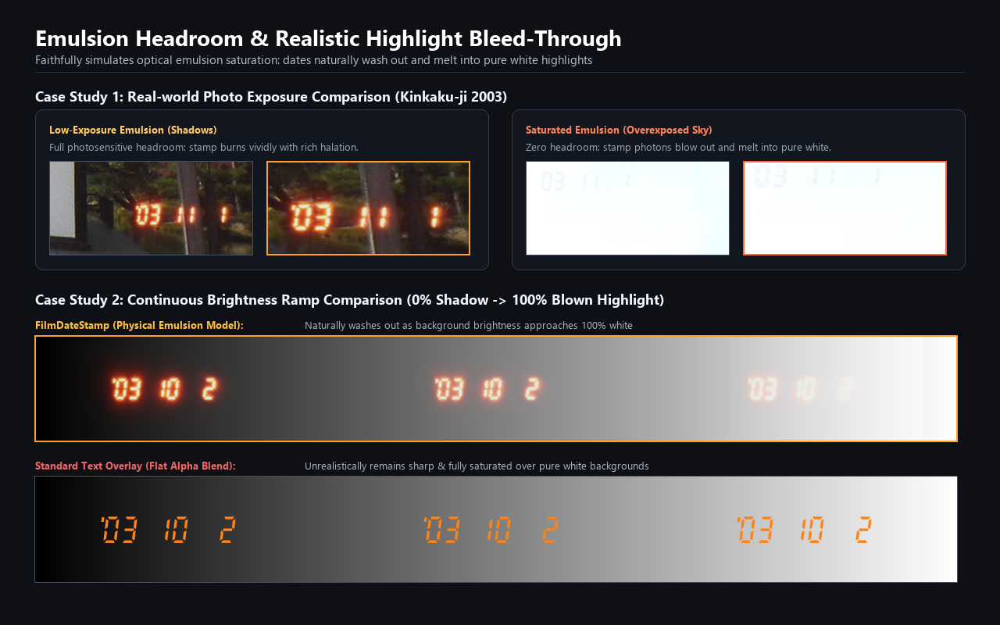
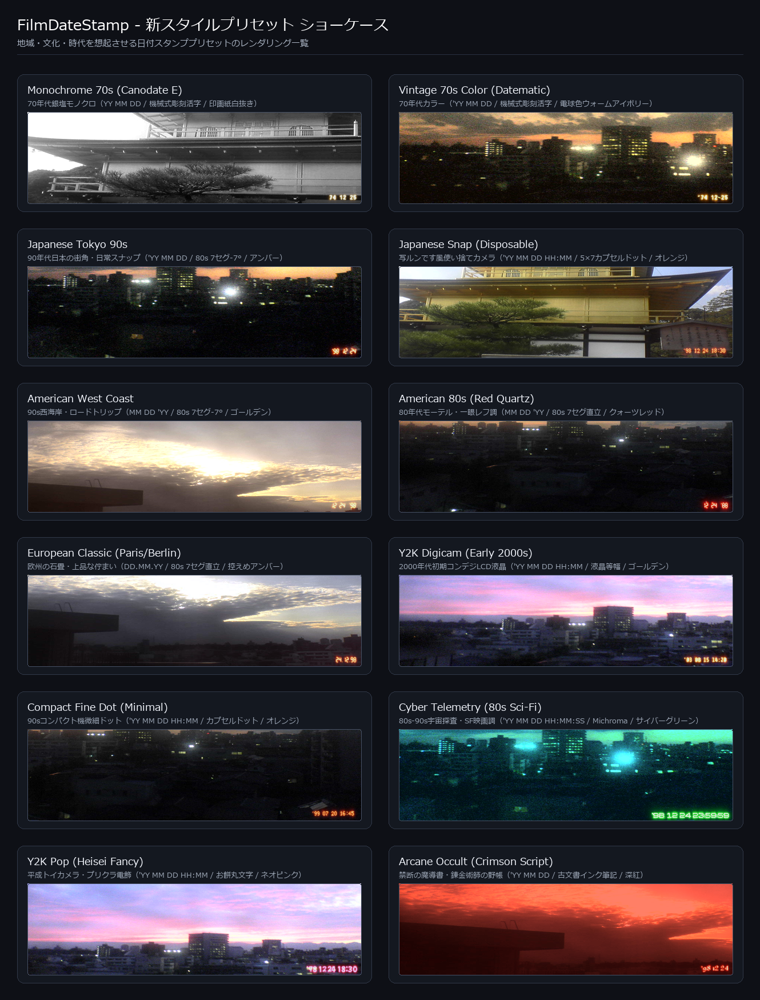

# FilmDateStamp (ComfyUI Custom Node)

[English](README.md) | [日本語](README_ja.md)



フィルム写真の感光乳剤に焼き付けられる「クォーツデート（日付スタンプ）」の光学・物理質感を徹底追及した、ComfyUI専用のカスタムノードパッケージです。

単なる「文字の貼り付け（透過オーバーレイ）」ではなく、**「フィルム乳剤へのLED露光（光の焼き付け）」**を物理的にシミュレートします。

---

## 🌟 主な特徴

### 1. 光学感光（Optical Burn-in）物理モデル vs 従来の文字貼り付け
フィルム乳剤への光子照射を物理シミュレート（リニア空間での加算露光 ＋ 乳剤未感光余力（Headroom）合成 ＋ フィルム肩特性ロールオフ）。
- **中心フィラメント芯（Hotspot Ridge）**: セグメントの中心線が物理的に白飛び（ブリーチ）し、外側に向かって橙・赤へと波長順に感光飽和します。
- **多重スケールPSF散乱**: 狭角前方散乱（Mie）からベース裏面・圧板反射ハレーションまで多重スケールで光が拡散。
- **3階層の有機的ゆらぎ**: LED素子の個体差（±10%）、裏蓋圧板の密着ムラによる波打ち、銀塩粒子の色素雲による輪郭のちぎれ。



### 2. リアルなハイライト埋もれ再現（Emulsion Headroom）
背景が明るい／白い写真では、感光乳剤が飽和して日付の光が自然に溶け込んで見えにくくなる「実物の白飛び現象」を忠実に再現します。



### 3. 実機幾何学フォント ＆ 特殊・空想フォント（厳選8種・完全自社製TrueType中心）
- `FDSMechanical70s`: 1970s機械式活字彫刻・DIN 1451/JIS工業彫刻文字準拠（Canon Canodate E / Datematic）
- `FDS7Strict-Compact`: 1980s諏訪精工舎モジュール実機幾何学完全準拠・前傾-7.0°（Autoboy, L35AD等）
- `FDS7Strict-SLR`: 1980s一眼レフデータバック直立実機準拠・直立0.0°（Nikon MF-12/14/16等）
- `FDSDotStrict`: 1990s写ルンです・高級コンパクト機 5×7縦長カプセルドット完全準拠
- `ShareTechMono`: 90〜2000年代コンデジ・カシオG-SHOCK等幅液晶
- `Michroma`: 80s-90s宇宙探査機・SF映画調テレメトリ（超ワイド幾何学HUD）
- `MochiyPopOne`: 平成レトロお餅丸文字・プリクラ電飾（Kawaiiポップ）
- `EagleLake`: 錬金術師の野帳・古文書インク手書き筆記（魔導スクリプト）

### 4. 視覚サイズ自動正規化（Visual Size Normalization）
フォント内部の余白・仮想ボディ比率の差を自動吸収。フォントを切り替えても、同じ `font_scale` で均一な大きさと右下端の正確なマージン位置を維持します。

### 5. 直感的な日付指定と時刻トグル (`show_time`)
- `date_string` にそのまま文字を入力すれば直接カスタム描画（例: `'98 12 24'`）。
- `"auto"` または `"today"` と入力すれば実行時の現在日時を自動生成。
- `"random"` と入力すれば1985〜2005年のランダム日時をシード再現性を持って自動生成。
- `show_time` の True/False で時刻表示（`HH:MM`）をワンクリック切り替え。

### 6. 地域・文化・時代・世界観を想起させる豊富なスタイルプリセット
ワンクリックで各時代・各地域の象徴的な写真表現を呼び出せます：



- `Japanese Tokyo 90s`: 90年代日本の街角・日常スナップ（'YY MM DD / 80s 7セグ-7° / アンバー）
- `Japanese Snap (Disposable)`: 写ルンです風・5×7カプセルドット・時分併記（'YY MM DD HH:MM / オレンジ）
- `American West Coast`: 90年代西海岸・ロードトリップ（MM DD 'YY / 80s 7セグ-7° / ゴールデン）
- `American 80s (Red Quartz)`: 80年代モーテル・一眼レフ・赤色LED（MM DD 'YY / 80s 7セグ直立 / クォーツレッド）
- `European Classic (Paris/Berlin)`: 欧州の石畳・上品で控えめな露光（DD.MM.YY / 80s 7セグ直立 / 控えめアンバー）
- `Y2K Digicam (Early 2000s)`: 2000年代初頭の初期コンデジLCD液晶（'YY MM DD HH:MM / 液晶等幅 / ゴールデン）
- `Compact Fine Dot (Minimal)`: 90年代コンパクト機微細カプセルドット（'YY MM DD HH:MM / オレンジ）
- `Monochrome 70s (Canodate E)`: 70年代銀塩モノクロ（YY MM DD / 機械式活字 / 印画紙白抜き）
- `Vintage 70s Color (Datematic)`: 70年代ヴィンテージカラー（'YY MM DD / 機械式活字 / 電球色ウォームアイボリー）
- `Cyber Telemetry (80s Sci-Fi)`: 80s-90s宇宙探査機・SF映画調テレメトリ（'YY MM DD HH:MM:SS / Michroma / サイバーグリーン）
- `Y2K Pop (Heisei Fancy)`: 平成レトロお餅丸文字・プリクラ電飾（'YY MM DD HH:MM / MochiyPopOne / ネオピンク）
- `Arcane Occult (Crimson Script)`: 錬金術師の野帳・古文書インク筆記（'YY MM DD / EagleLake / 深紅）

### 7. 多機能な出力スロット（MASK & STRING 対応）
- **`IMAGE`**: 物理感光露光が焼き付けられた完成画像。
- **`MASK`**: スタンプ発光領域の高精度アルファマスク（0.0〜1.0）。文字コアは完全な白（1.0）、ハレーション部分は滑らかな減衰グラデーションとなり、後段で日付部分だけにフィルム粒子を乗せたり、Inpaintで日付を除去する際に活用可能。
- **`STRING`**: 実際に描画された日付文字列（例: `'98 12 24 18:30'`）。SaveImage のファイル名プレフィックスやキャプション等にシームレスに連携可能。

---

## 📦 インストール方法

### 方法 1: ComfyUI-Manager（推奨）
ComfyUI-Manager の検索ウィンドウで `Film Date Stamp` または `FilmDateStamp` を検索し、「Install」をクリックしてください。

### 方法 2: Git Clone
ComfyUI の `custom_nodes` ディレクトリに移動し、クローンしてください：
```bash
cd ComfyUI/custom_nodes
git clone https://github.com/rec-frame/FilmDateStamp.git
```

---

## 🚀 使い方

1. ComfyUI のノード追加メニューより、`image` > `film` > **`Film Date Stamp (Optical Burn-in)`** を選択。
2. 最上段の **`style_preset`** からお好みの世界観（`Japanese Tokyo 90s` や `American West Coast` など）を選ぶと、フォント・色・発光・日付順が一発で自動セットされます。
3. パラメータを手動で動かすと自動的に `Custom` に切り替わり、自由な微調整が可能です。
4. サンプルワークフローは `workflows/film_date_stamp_workflow.json` を ComfyUI 画面にドラッグ＆ドロップしてください。

---

## ⚙️ パラメータ仕様

| パラメータ名 | 区分 | 型 / 選択肢 | デフォルト | 説明 |
|---|---|---|---|---|
| `style_preset` | 必須 | `Custom`, `Japanese Tokyo 90s`, `American West Coast`, etc. | `Custom` | スタイル一括プリセット（最上段） |
| `font_type` | 必須 | 厳選8フォント（自社製Strict 4種 + 液晶等幅1種 + 空想3種） | `FDS7_Strict_Compact (80s -7°)` | 発光素子タイポグラフィ |
| `preset_color` | 必須 | `Amber Classic`, `Quartz Red`, `Fuji Orange`, `Golden Yellow`, `Bulb Warm Ivory`, `Paper White`, `Cyber Green`, `Neo Pink`, `Crimson Red` | `Amber Classic` | 発光スペクトルプリセット（特殊なCyber/Neo/Crimsonは末尾） |
| `exposure_intensity`| 必須 | FLOAT (0.0〜2.0) | `1.0` | 露光光量全体の強度 |
| `core_glow` | 必須 | FLOAT (0.0〜2.0) | `1.0` | 中心白コアの強さ |
| `halation` | 必須 | FLOAT (0.0〜3.0) | `1.0` | 赤色乳剤散乱の広がり・強さ |
| `date_string` | 必須 | STRING | `'98 12 24` | 直接文字入力、または `"auto"` / `"today"` / `"random"` |
| `date_format` | 必須 | `'YY MM DD`, `MM DD 'YY`, `DD MM 'YY`, `DD.MM.YY`, `YY-MM-DD`, `YY.MM.DD`, `YYYY MM DD`, `YYYY-MM-DD` | `'YY MM DD` | 自動日時生成時のフォーマット記法 |
| `show_time` | 必須 | BOOLEAN | `False` | 時刻（HH:MM）の表示・非表示トグル |
| `position` | 必須 | `bottom_right`, `bottom_left`, `top_right`, `top_left` | `bottom_right` | スタンプの配置位置 |
| `font_scale` | 必須 | FLOAT (0.5〜2.5) | `1.0` | 画像短辺に対するフォントスケール |
| `margin` | 必須 | FLOAT (0.0〜3.0) | `1.0` | 画面端からの等方マージン倍率 |
| `seed` | 任意 | INT | `0` | ランダム日時および有機的ゆらぎの再現用シード |
| `irregularity` | 任意 | FLOAT (0.0〜2.0) | `1.0` | 3階層有機的ゆらぎの強度倍率 |

### 📤 出力スロット

| スロット名 | 型 | 説明 |
|---|---|---|
| `image` | `IMAGE` | 日付スタンプが光学的に露光・焼き付け合成されたテンソル画像 `[B, H, W, C]` |
| `mask` | `MASK` | スタンプ領域のアンチエイリアス付き高精度マスク `[B, H, W]`（文字部 1.0、ハレーション部 減衰値、背景 0.0） |
| `date_text` | `STRING` | 実際に描画された日付・時刻文字列（例: `'98 12 24'` や `'98 12 24 18:30'`）。後段の保存ノードやテキスト連携に利用可能 |

---

## 📄 ライセンス

- コード: MIT License
- 同梱フォント: SIL Open Font License 1.1 (`fonts/LICENSE-OFL.txt`)
