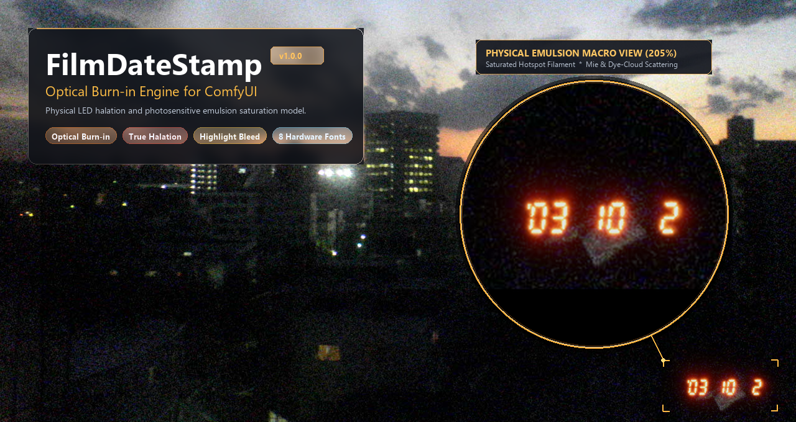
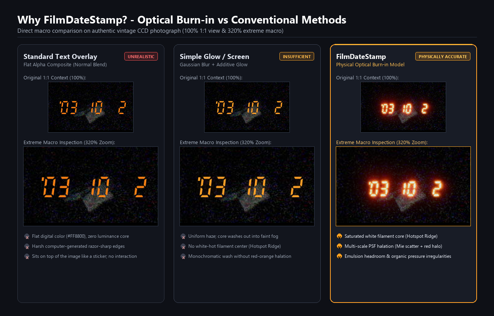
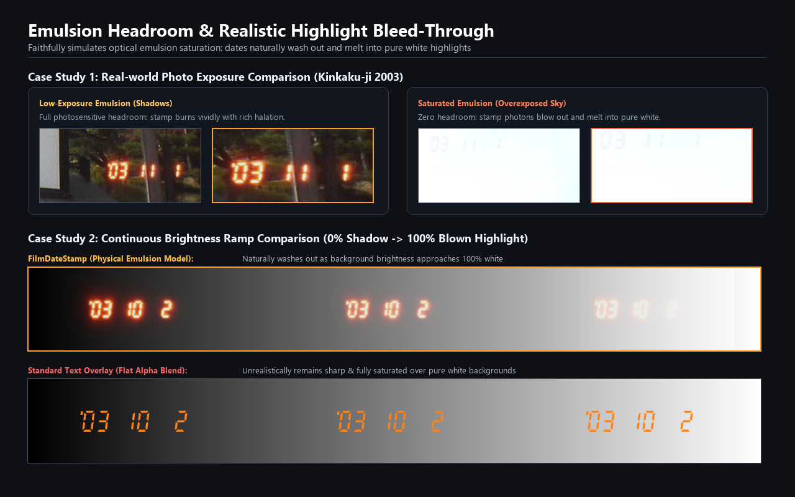
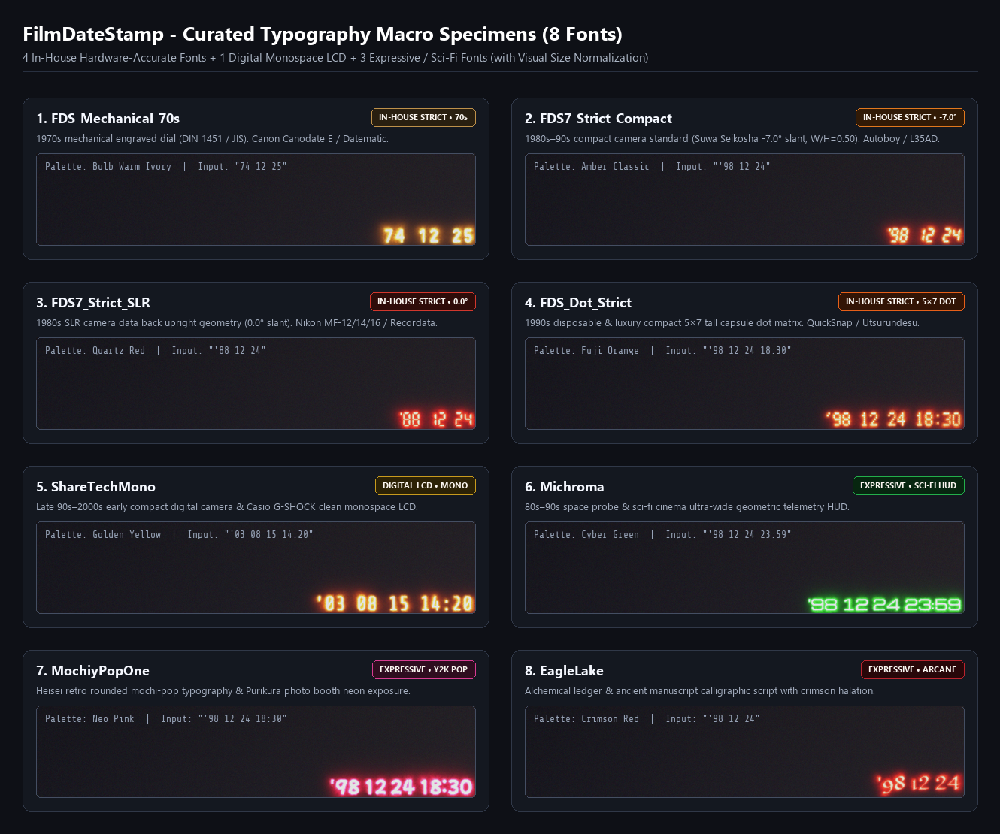
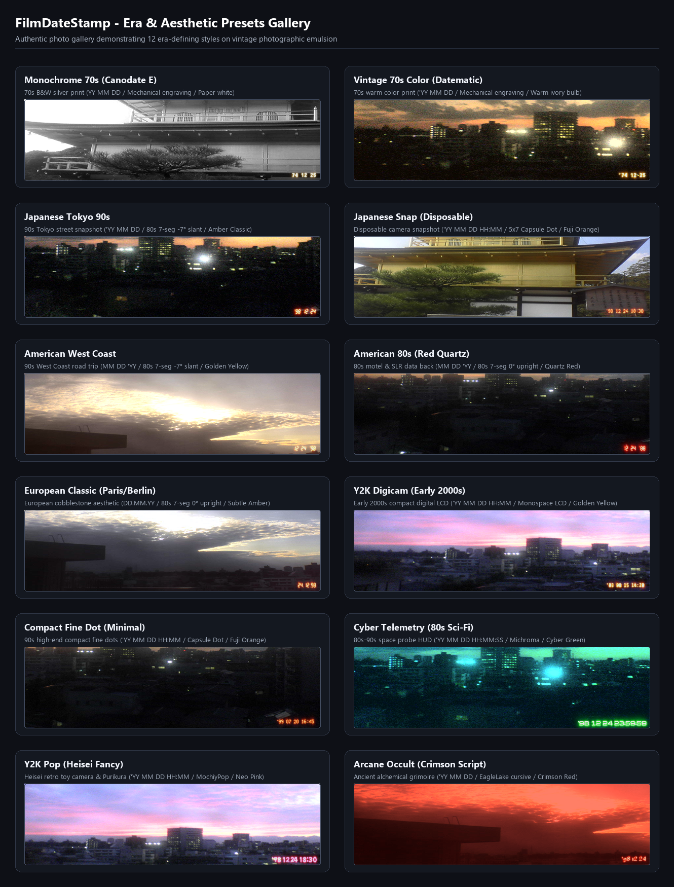

<div align="center">

# 🎞️ FilmDateStamp

### 物理级再现胶片感光曝光、光晕晕影与高光过曝溶蚀的 ComfyUI 自定义节点

[](https://github.com/treeturtlefall-arch/FilmDateStamp/releases)
[](https://github.com/comfyanonymous/ComfyUI)
[](https://www.python.org/)
[](#7-阶段物理光学渲染管线)
[](LICENSE)
[](fonts/LICENSE-OFL.txt)

**[🇺🇸 English](README.md)** | **[🇯🇵 日本語 (Japanese)](README_ja.md)** | **[🇨🇳 简体中文 (Chinese)](README_zh.md)**

[为何需要“光学感光”？](#-为何需要光学感光optical-burn-in) •
[乳剂余量与高光溶蚀](#%EF%B8%8F-胶片乳剂感光余量与高光溶蚀再现) •
[精选 8 款字体](#-精选-8-款字体与视觉尺寸自动归一化) •
[12 款经典风格预设](#-12-款时代风貌风格预设) •
[安装指南](#-安装方法) •
[参数参考](#%EF%B8%8F-参数参考)

<br>



*告别机械生硬的“文字贴纸”。真实模拟相机后背微型发光二极管直接照射、激发并饱和银盐与染料感光乳剂的物理过程。*

</div>

---

## 🔬 为何需要“光学感光（Optical Burn-in）”？

在真实的 35mm 胶片机、单反数据后背或一次性相机上，石英日期戳（Quartz Date）**绝非印在洗印照片表面的油墨贴字**。它的本质是：在按下快门的瞬间，安装在相机后盖压片板内部的微型发光二极管（LED）或微型白炽灯泡，透过微透镜阵列从后方**直接对未经显影的感光乳剂层（卤化银与彩色染料偶联剂）进行光子照射与局部过度曝光**。

传统的后期数字化处理（图层贴图、或简单的“高斯模糊＋滤色/屏幕混合”）往往带有一层挥之不去的“塑料贴纸感”。**FilmDateStamp** 采用 7 阶段物理光学模型，彻底还原真实的胶片烧录质感：

| 光学特性 | 传统文字贴图 | 简单高斯发光合成 | **FilmDateStamp（物理光学感光模型）** |
| :--- | :---: | :---: | :---: |
| **字划中心（白炽核心脊线）** | ❌ 扁平单色填充 | ❌ 模糊泛白，核心结构消散 | ✅ 欧氏距离变换提取的**过曝白炽灯丝核心（Hotspot Ridge）** |
| **色彩空间渐变** | ❌ 始终保持单一固定 RGB | ❌ 单色透明度淡化渐变 | ✅ **H&D 分光感光饱和**（`红` → `橙` → `琥珀金` → `暖白` 逐层过曝） |
| **光散射（PSF）** | ❌ 锐利的数字矢量硬边 | ⚠️ 单一固定半径模糊 | ✅ **多尺度各向异性 PSF**（窄角米氏正向散射 ＋ 广角片基反射光晕） |
| **高亮过曝背景表现** | ❌ 悬浮在过曝天空上方如贴纸 | ⚠️ 不自然的生硬裁切 | ✅ **线性乳剂感光余量（Headroom）**（自然融入并湮灭于高光过曝区） |
| **模拟有机波动** | ❌ 100% 完美的电脑字体 | ❌ 100% 均匀的机械模糊 | ✅ **三层有机扰动**（元件光强公差、压片板微弯曲、染料云颗粒感） |



---

## ☀️ 胶片乳剂感光余量与高光溶蚀再现

当画面拍摄了逆光天空、明亮车灯或纯白墙面等强光区域时，该区域胶片乳剂中的卤化银晶体与染料偶联剂**已被环境强光充分激发至饱和状态**，不再具备承载更多曝光光子的剩余容量（*Emulsion Headroom*）。

FilmDateStamp 会将输入底图转换至线性光空间（$sRGB \to \text{Linear}$），在精确计算每个像素未感光容量的基础上应用胶片肩部非线性滚降曲线（Soft Shoulder Roll-off）：

$$I_{\text{exposed}} = \frac{I_{\text{base}} + L_{\text{stamp}}}{1.0 + \max(0,\, I_{\text{base}} + L_{\text{stamp}} - 1.0) \times k_{\text{shoulder}}}$$

- **暗部/阴影区域 ($I_{\text{base}} \approx 0$)**: 胶片乳剂保留了充足的感光余量，LED 的发光能量被完全吸收，呈现出耀眼的白色灯丝核心与层层绽放的橙红晕影。
- **高光/白过曝区域 ($I_{\text{base}} \approx 1$)**: 乳剂感光容量已耗尽，日期戳的光子随之融解在背景的高光之中，忠实再现了**“真实胶片照片上日期戳淹没在晴朗天空中、难以辨识”**的标志性物理现象。



---

## 🔤 精选 8 款字体与视觉尺寸自动归一化

内置 **4 款完全自主重构的真实硬件几何 TrueType 字体**（精准还原 70–90 年代经典相机模块）、**1 款整洁的等宽数字液晶字体**，以及 **3 款富有表现力与幻想色彩的特殊字体**——全部基于 **SIL Open Font License 1.1** 开源协议提供。



| 字体选项 (`font_type`) | 类别 | 几何与光学设计规范 | 时代背景与硬件灵感原型 |
| :--- | :--- | :--- | :--- |
| **`FDS_Mechanical_70s (70s Mechanical)`** | ★ 自主原创建模 | 遵循 DIN 1451 / JIS 工业刻字标准、圆头胶囊 `0`、弯钩 `1`、倾斜短划 `'` | **1970年代机械转轮刻印**: 佳能 Canodate E (1970)、Datematic (1974)、Data Back A |
| **`FDS7_Strict_Compact (80s -7°)`** | ★ 自主原创建模 | 严格遵循精工爱普生（Suwa Seikosha）7段数码管几何规范（宽高比 $W/H=0.50$、**前倾角 $-7.0^\circ$**）、悬浮点 `'` | **1980–90年代便携傻瓜机黄金时代**: 佳能 Autoboy、尼康 L35AD（Pikaichi）、奥林巴斯 AF-10 |
| **`FDS7_Strict_SLR (80s 0°)`** | ★ 自主原创建模 | 单反数据后背直立 7 段管几何规范（宽高比 $W/H=0.50$、**直立 $0.0^\circ$**）、悬浮点 `'` | **1980年代单反数据后背**: 尼康 MF-12 / MF-14 / MF-16、奥林巴斯 Recordata、美能达 Data Back G |
| **`FDS_Dot_Strict (90s Dot Matrix)`** | ★ 自主原创建模 | $5\times7$ 矩阵高长宽比微胶囊点阵（$65\times80$）、镂空 `0`、对角双点撇号 `'` | **1990年代一次性相机与高级便携机**: 富士 QuickSnap（一次性相机）、Cardia/Tiara、理光 GR1 |
| **`ShareTechMono (LCD Digital)`** | 数字等宽液晶 | 规整现代的等宽数字 LCD 比例 | **90年代末至2000年代初早期数码机**: 早期 CCD 消费级数码相机、卡西欧 G-SHOCK |
| **`Michroma (Cyber Telemetry)`** | 表现力 / 赛博科幻 | 超宽幅几何扁平 Euro-Stile 比例 | **80–90年代太空科幻 HUD**: 深空探测器遥测数据、《银翼杀手》/《EVA》光学显示界面 |
| **`MochiyPopOne (Y2K Pop)`** | 表现力 / 可爱甜美 | 如年糕般圆润膨胀的复古可爱波普圆体 | **平成复古潮流**: 限定款玩具胶卷相机、日本大头贴机（Purikura）霓虹光晕 |
| **`EagleLake (Arcane Script)`** | 表现力 / 秘术手札 | 具有手写羽毛笔与墨水枯竭顿挫感的神秘花体 | **秘术与黑暗奇幻**: 炼金术士野外日志、禁断魔导书、SCP 基金会机密档案 |

> [!TIP]
> **视觉尺寸自动归一化（Visual Size Normalization）**: 传统字体的内部 EM 框与字形上下留白各不相同。FilmDateStamp 会自动将所有字体的字形高度归一化为统一视觉比例（在 `font_scale = 1.0` 时为图像短边的 $4.0\%$），并使用**发光像素的最小外接紧凑包围盒**进行裁切对齐。无论你在 8 款字体之间如何随意切换，无需手动反复调整 `font_scale` 或 `margin`，文字视觉体量与边角留白均能保持完全一致。

---

## 🎨 12 款时代风貌风格预设

只需在节点顶部的 **`style_preset`** 下拉菜单中选择一个预设，即可一键自动配置字体、分光发光色谱、曝光能量、灯丝白炽强度、暗房光晕以及各地区的习惯日期排版。



### 📸 真实硬件经典预设（9 款）

| 风格预设名称 | 字体几何 | 分光发光色谱 | 日期与时间格式 | 美学定位与时代文化背景 |
| :--- | :--- | :--- | :--- | :--- |
| **`Japanese Tokyo 90s`** | `FDS7_Strict_Compact` (-7°) | `Amber Classic` | `'YY MM DD` | 90 年代日本街头与日常抓拍的标志性温润经典琥珀金光晕 |
| **`Japanese Snap (Disposable)`** | `FDS_Dot_Strict` (5×7 Dot) | `Fuji Orange` | `'YY MM DD HH:MM` | 富士一次性胶卷机（QuickSnap）经典亮橙色 5×7 胶囊点阵并附带时间 |
| **`American West Coast`** | `FDS7_Strict_Compact` (-7°) | `Golden Yellow` | `MM DD 'YY` | 沐浴在加州阳光下的 90 年代美西公路公路旅行风，采用美式月-日-年排版 |
| **`American 80s (Red Quartz)`** | `FDS7_Strict_SLR` (0°) | `Quartz Red` | `MM DD 'YY` | 80 年代美国汽车旅馆与单反数据后背特有的深邃纯红 LED 散色光晕 |
| **`European Classic (Paris/Berlin)`** | `FDS7_Strict_SLR` (0°) | `Amber Classic` | `DD.MM.YY` | 欧洲石板路与文艺片质感，采用点号分隔符的欧式日.月.年排版 (`DD.MM.YY`) |
| **`Y2K Digicam (Early 2000s)`** | `ShareTechMono` (LCD) | `Golden Yellow` | `'YY MM DD HH:MM` | 2000 年代初早期 CCD 消费级数码相机 LCD 液晶时间戳印记 |
| **`Compact Fine Dot (Minimal)`** | `FDS_Dot_Strict` (5×7 Dot) | `Fuji Orange` | `'YY MM DD HH:MM` | 90 年代高级钛合金便携机（如 Tiara/GR1）的极细微胶囊点阵曝光 |
| **`Monochrome 70s (Canodate E)`** | `FDS_Mechanical_70s` | `Paper White` | `YY MM DD` | 1970 年代黑白银盐印相纸上干净纯粹的光学遮罩露白效果 |
| **`Vintage 70s Color (Datematic)`** | `FDS_Mechanical_70s` | `Bulb Warm Ivory` | `'YY MM DD` | 1970 年代微型白炽灯泡（钨丝灯）在早期彩色胶片上留下的暖象牙色印记 |

### ✨ 表现力与幻想风格预设（3 款）

| 风格预设名称 | 字体几何 | 分光发光色谱 | 日期与时间格式 | 美学定位与时代文化背景 |
| :--- | :--- | :--- | :--- | :--- |
| **`Cyber Telemetry (80s Sci-Fi)`** | `Michroma` | `Cyber Green` | `'YY MM DD HH:MM:SS` | 80–90 年代太空科幻高精度绿色激光遥测 HUD（自动追加精准到秒 `:SS`） |
| **`Y2K Pop (Heisei Fancy)`** | `MochiyPopOne` | `Neo Pink` | `'YY MM DD HH:MM` | 平成复古可爱风，如日本大头贴机电闪与玩具相机般的甜美粉紫米氏散射 |
| **`Arcane Occult (Crimson Script)`** | `EagleLake` | `Crimson Red` | `'YY MM DD` | 炼金术士手稿、禁忌血契与 SCP 机密档案般的猩红血迹晕影 |

---

## 🧬 7 阶段物理光学渲染管线

<details>
<summary><b>点击展开物理渲染引擎的内部架构与数学机理</b></summary>

<br>

```text
                       [ 曝光能量 E 的空间分布 ]
                     过饱和白炽灯丝核心 (Hotspot Ridge)
                                  ┌───────────┐
                                  │           │
                       窄角正向米氏散射 (Mie Scattering Body)
                          ┌───────┴───────────┴───────┐
                          │                           │
                广角片基与后盖压片板反射光晕 (Wide Halation Wave)
                ┌─────────┴───────────────────────────┴─────────┐
             ───┴───────────────────────────────────────────────┴─── (胶片感光乳剂层)
```

1. **阶段 1 — 欧氏距离变换脊线与微缝衍射（Euclidean Distance Ridge & Blooming）**: 提取笔画骨架中心线，精准模拟位于 LED 芯片正上方的最高强度光点，并通过微狭缝衍射算法消除数字矢量的生硬直角。
2. **阶段 2 — 宏观扰动（元件功率公差微颤）**: 模拟各个发光管段或点阵 LED 间 ±10% 的制造工艺公差，以及微型投影透镜的边缘照度衰减。
3. **阶段 3 — 多尺度各向异性 PSF 散射卷积**: 结合窄角正向米氏散射（形成主体琥珀色光晕）、广角片基反射散射（形成外围红晕）与超广角薄纱眩光，同时融入微弱的各向异性展宽。
4. **阶段 4 — 介观扰动（压片板微翘曲与场域扭曲）**: 引入低频类柏林云状形变场，模拟胶卷在压片板与片门间微小的接触不平整，赋予外层光晕自然的有机微波浪边缘。
5. **阶段 5 — 微观扰动（卤化银颗粒度与染料云裂解）**: 注入感光阈值噪声。保持高强度中心核心光滑平稳的同时，仅使外围极微弱的光晕边缘自然裂解为离散的感光染料云（Dye Clouds）。
6. **阶段 6 — H&D 分光感光饱和模型（Spectrophotometric Bleaching）**: 基于胶片感光曲线计算各色彩通道的响应 $I = 1.0 - \exp(-E^\gamma)$。微弱能量仅激发长波长红光层；中等能量唤醒绿光层（混合为橙黄色）；高能量核心层饱和激活蓝光层，在视觉上自然呈现脱色泛白的暖白核心。
7. **阶段 7 — 线性乳剂容量（Emulsion Headroom）合成**: 将底图转入线性空间，根据底图未饱和容量（$1.0 - L_{\text{base}}^{1.35} \times 0.72$）调配印字光子能量，经由软肩曲线（Soft Shoulder Roll-off）物理压缩后转回 sRGB。

</details>

---

## 📦 安装方法

### 方法 1: ComfyUI-Manager（推荐）
打开 **ComfyUI-Manager**，搜索 **`Film Date Stamp`**（或 `FilmDateStamp`），点击 **Install** 即可。

### 方法 2: Comfy-CLI
```bash
comfy node install comfyui-film-date-stamp
```

### 方法 3: 手动 Git Clone
在 ComfyUI 的 `custom_nodes` 目录下克隆本仓库：
```bash
cd ComfyUI/custom_nodes
git clone https://github.com/treeturtlefall-arch/FilmDateStamp.git
```
*(无需额外安装复杂的 pip 依赖——完全基于 ComfyUI 自带的 `torch`、`numpy` 和 `Pillow` 运行，轻巧高速。)*

---

## 🚀 快速上手与工作流搭建

1. **添加节点**: 在 ComfyUI 画布空白处右键 → `image` → `film` → **`Film Date Stamp (Optical Burn-in)`**。
2. **选择氛围**: 从节点最上方的 **`style_preset`** 下拉菜单中选择一款契合画风的经典预设。
3. **随心微调**: 任意拖动调节滑块（如 `font_type`、`preset_color`、`halation` 等），前端扩展将自动无缝切换为 `Custom` 模式供你自由定制。
4. **示例工作流**: 直接将 [`workflows/film_date_stamp_workflow.json`](workflows/film_date_stamp_workflow.json) 拖入 ComfyUI 窗口即可加载完整测试流程。

### 💡 智能日期输入 (`date_string`)
无需复杂的模式切换开关，只需在 `date_string` 文本框中输入你想要的内容：
- **自定义日期文本**: 直接输入任何文字，例如 `'98 12 24` 或 `'95 08 15 14:30`。
- **获取当前系统时间**: 输入 `"auto"`、`"today"` 或 `"now"`，节点将自动根据 `date_format` 与 `show_time` 生成运行时的系统日期。
- **经典年代随机生成**: 输入 `"random"`，节点将在 1985–2005 年间随机生成具有复古怀旧感的时间戳，受 `seed` 确定性控制，便于工作流复现。

### 🔌 3 个输出接口的高级玩法
- **`image` (`IMAGE`)**: 已物理感光烧录合成完成的高品质胶片图像张量 `[B, H, W, C]`。
- **`mask` (`MASK`)**: 针对发光区域的高精度遮罩 `[B, H, W]`（中心核心为 `1.0`，外围光晕为柔和衰减渐变）。非常适合连接到下游的 **Film Grain（胶片颗粒）** 节点，实现“仅在发光的染料云上追加胶片噪点”，或接入 **Inpaint（局部重绘）** 节点进行无痕除字。
- **`date_text` (`STRING`)**: 最终实际渲染在画面上的日期时间字符串（例如 `'98 12 24 18:30`）。可直接接入 `SaveImage` 节点作为文件名保存前缀，或送入图生文标签工作流。

---

## ⚙️ 参数参考

| 参数名称 | 类型 | 默认值 | 范围 / 选项 | 详细说明 |
| :--- | :--- | :--- | :--- | :--- |
| **`style_preset`** | `COMBO` | `Custom` | `Custom` + 12 款预设 | 顶层风格大师。选中后自动一键覆盖配置字体、色谱、曝光与日期格式 |
| **`font_type`** | `COMBO` | `FDS7_Strict_Compact (80s -7°)` | 精选 8 款字体 | 发光元件排版字体（全系支持视觉尺寸自动归一化） |
| **`preset_color`** | `COMBO` | `Amber Classic` | 9 组分光色谱 | 物理发射光谱（6 组复刻真实硬件 ＋ 3 组奇幻表现力色谱） |
| **`exposure_intensity`** | `FLOAT` | `1.00` | `0.00` – `2.00` | 照射到胶片感光乳剂上的总光子曝光能量倍率 |
| **`core_glow`** | `FLOAT` | `1.00` | `0.00` – `2.00` | 笔画中心白炽灯丝过曝核心（Hotspot Ridge）的强度 |
| **`halation`** | `FLOAT` | `1.00` | `0.00` – `3.00` | 片基与压片板多尺度红色乳剂光晕的扩散半径与发散强度 |
| **`date_string`** | `STRING` | `'98 12 24` | 文本 / `"auto"` / `"random"` | 烧录的字面文本，或动态生成指令关键字（`"auto"`, `"today"`, `"random"`） |
| **`date_format`** | `COMBO` | `'YY MM DD` | 9 种排版格式 | 动态生成日期或预设重置时的年月日排序与分隔符语法 |
| **`show_time`** | `BOOLEAN` | `False` | `True` / `False` | 是否在日期后追加具体时间戳（`HH:MM`，赛博预设为 `HH:MM:SS`） |
| **`position`** | `COMBO` | `bottom_right` | `bottom_right`, `bottom_left`, `top_right`, `top_left` | 画面四角布局位置（基于真实发光像素最小外接包围盒精准对齐） |
| **`font_scale`** | `FLOAT` | `1.00` | `0.50` – `2.50` | 相对于画面短边的字形大小比例倍率（基准为短边的 $4.0\%$） |
| **`margin`** | `FLOAT` | `1.00` | `0.00` – `3.00` | 距画面边缘的留白边距倍率（水平/垂直比约为 5:4） |
| **`irregularity`** *(可选)* | `FLOAT` | `1.00` | `0.00` – `2.00` | 三层有机物理扰动强度（`0.0`=完全平整机械，`1.0`=真实实机，`2.0`=强调） |
| **`seed`** *(可选)* | `INT` | `0` | `0` – `2^64-1` | 随机日期生成与有机扰动噪点形态的确定性种子 |

<details>
<summary><b>🌈 分光发光色谱一览 ＆ 区域日期排版记法一览（点击展开）</b></summary>

### 分光发光色谱 (`preset_color`)

| 色谱名称 | 核心色 (RGB) | 主发光色 (RGB) | 光晕色 (RGB) | 视觉特征与经典原型 |
| :--- | :---: | :---: | :---: | :--- |
| **`Amber Classic`** | `(255, 255, 210)` | `(255, 130, 20)` | `(240, 45, 0)` | 90 年代经典便携傻瓜相机的标志性琥珀金发光 |
| **`Quartz Red`** | `(255, 230, 220)` | `(255, 40, 20)` | `(200, 10, 0)` | 80 年代经典单反石英数据后背深邃沉郁的纯红 LED 散光 |
| **`Fuji Orange`** | `(255, 250, 190)` | `(255, 115, 20)` | `(250, 60, 10)` | 富士一次性胶卷机（QuickSnap）特有明亮温暖的鲜橙色发光 |
| **`Golden Yellow`** | `(255, 255, 240)` | `(255, 185, 30)` | `(240, 110, 0)` | 90 年代末至千禧年便携机常见的金黄色高亮发光 |
| **`Bulb Warm Ivory`** | `(255, 250, 232)` | `(255, 242, 204)` | `(255, 214, 138)` | 1970 年代微型白炽钨丝灯泡（Datematic 等）温暖复古的象牙白 |
| **`Paper White (Monochrome)`** | `(248, 246, 240)` | `(245, 242, 234)` | `(235, 232, 224)` | 1970 年代黑白银盐冲印相纸上的遮光无感光露白（Canodate E 等） |
| **`Cyber Green`** *(特殊表现)* | `(230, 255, 230)` | `(40, 255, 80)` | `(0, 180, 40)` | 太空探测器遥测 HUD、王家卫电影质感的荧光绿激光光晕 |
| **`Neo Pink`** *(特殊表现)* | `(255, 235, 248)` | `(255, 70, 170)` | `(230, 25, 115)` | 平成复古大头贴机、少女心玩具相机弥漫的霓虹粉紫米氏光晕 |
| **`Crimson Red`** *(特殊表现)* | `(255, 235, 225)` | `(235, 25, 35)` | `(185, 5, 15)` | 禁忌古籍血迹手写、SCP 异常档案的深暗猩红侵蚀光晕 |

### 区域日期排版记法 (`date_format`)

| 排版语法 | 输出样例 (`show_time=False`) | 输出样例 (`show_time=True`) | 区域惯例与应用场合 |
| :--- | :--- | :--- | :--- |
| **`'YY MM DD`** | `'98 12 24` | `'98 12 24 18:30` | 日本与东亚主流标准（最深入人心的石英日期戳范式） |
| **`YY MM DD`** | `98 12 24` | `98 12 24 18:30` | 无撇号年份（1970 年代 Canodate E 等机械机型） |
| **`MM DD 'YY`** | `12 24 '98` | `12 24 '98 18:30` | 北美（美国）惯用月·日·年排版 |
| **`DD MM 'YY`** | `24 12 '98` | `24 12 '98 18:30` | 欧洲、英国与英联邦日·月·年排版 |
| **`DD.MM.YY`** | `24.12.98` | `24.12.98 18:30` | 德国及欧洲大陆传统点号日.月.年排版 |
| **`YY-MM-DD`** | `98-12-24` | `98-12-24 18:30` | 连字符紧凑分隔排版 |
| **`YY.MM.DD`** | `98.12.24` | `98.12.24 18:30` | 点号紧凑分隔排版 |
| **`YYYY MM DD`** | `1998 12 24` | `1998 12 24 18:30` | 完整 4 位公元纪年（支持千禧年规范模块） |
| **`YYYY-MM-DD`** | `1998-12-24` | `1998-12-24 18:30` | ISO 8601 标准 4 位连字符排版 |

</details>

---

## 📄 开源许可证

- **核心代码**: [MIT License](LICENSE)
- **内置字体 (`fonts/*.ttf`)**: [SIL Open Font License 1.1](fonts/LICENSE-OFL.txt)（包含 4 款自主原创建模实机几何字体 `FDS*` 以及 4 款精选开源 OFL 字体）。
